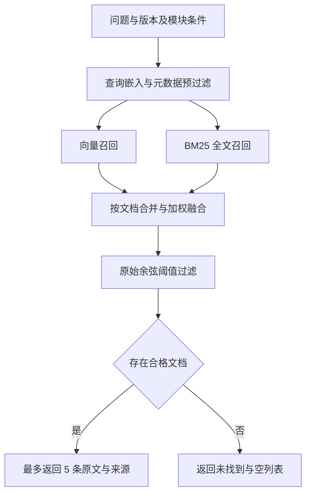
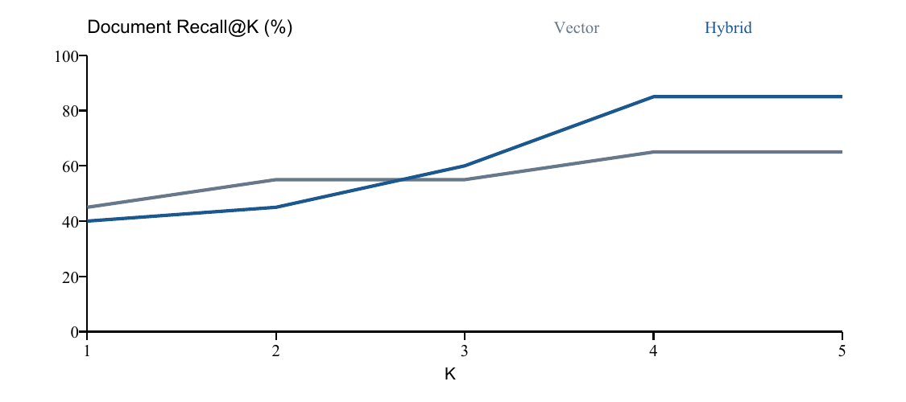

# Python 官方文档智能客服检索系统

基于 RAG 架构的客服知识库课程项目，使用 Python 官方中文标准库文档回答技术咨询。系统完成清洗、分块、嵌入、批量入库、索引、元数据过滤、混合检索及评估，返回原文证据和官方来源链接。

当前实现为命令行检索系统，覆盖 RAG 的检索与证据供给阶段；可选的大模型答案生成尚未接入。

| 数据与正式配置 | 2026-11-12 实测结果 |
|---|---|
| 20 个官方页面，1,388 条独立 API 文档 | 1,786 个文本块 |
| 420 字符分块，70 字符重叠 | Recall@5：**85.0%（17/20）** |
| BGE 中文嵌入 + LanceDB + BM25 | P95：**19.68 ms** |
| 6 条额外负例，含模块与版本过滤空集 | 全部返回“未找到” |

结果来源：[正式评估汇总](results/summary.json)、[逐题证据与计时](results/chunk_420_70_hybrid.json)、[负例结果](results/no_answer_after.json)。延迟是在本机串行、模型已加载条件下测得，其他设备的数值会不同。

## 快速开始

以下步骤适用于 Windows PowerShell，已使用 Windows 11、Python 3.12.14 运行。需要 Git 和 Python 3.12；`python --version` 应显示 3.12。首次安装依赖和下载嵌入模型需要联网，无需 GPU 或付费 API Key。

### 1 克隆并安装依赖

使用有仓库访问权限的 GitHub 账号克隆：

```powershell
git clone https://github.com/cnwky26-glitch/python-rag-customer-service.git
cd python-rag-customer-service
python --version
python -m venv .venv
.\.venv\Scripts\python.exe -m pip install -r requirements-lock.txt
```

直接调用虚拟环境中的 Python，无需激活脚本。`requirements.txt` 列出主要依赖，`requirements-lock.txt` 锁定本次运行环境的完整依赖；常规复现使用后者。`requirements-report.txt` 仅供生成作业报告使用，检索系统不需要安装它。

### 2 建立本地知识库

```powershell
.\.venv\Scripts\python.exe main.py build
```

仓库已包含清洗后的文档及原始 HTML 快照，可以直接建库。首次运行自动下载约 95 MB 的模型文件，缓存到 `.cache/models/`；后续可使用本地缓存。建库会生成 `storage/lancedb/`，并输出实际 Schema、索引与行数到 [建库记录](results/build_python_support.json)。

模型缓存、虚拟环境和本地数据库未上传 GitHub。**新克隆的仓库须先完成建库，再执行查询。** `build` 会重建配置指定的表。

### 3 执行检索

```powershell
.\.venv\Scripts\python.exe main.py query "如何递归复制整个目录树到另一个目录？" --module shutil
```

在已提交的正式评估中，该问题的首条结果为 `shutil:shutil.copytree`，来源为 [shutil.copytree 官方说明](https://docs.python.org/zh-cn/3.13/library/shutil.html#shutil.copytree)。完整输出包括：

| 输出字段 | 含义 |
|---|---|
| `status` | `找到` 或 `未找到` |
| `results` | 最多 5 条不同文档，含 `doc_id`、`chunk_id`、`title`、`text` 和 `source` |
| `similarity` | 单条结果的原始余弦相似度，用于阈值过滤 |
| `hybrid_score` | 单条结果的排序得分；混合模式下为加权融合分数 |
| `filters`、`threshold`、`mode` | 本次实际使用的过滤条件、阈值及检索方式 |
| `latency_ms` | 本次检索耗时，包含查询嵌入 |

检查无结果行为：

```powershell
# 知识库未覆盖的业务问题
.\.venv\Scripts\python.exe main.py query "我的快递丢失了，赔偿多少钱？"
# 不存在的模块
.\.venv\Scripts\python.exe main.py query "如何把对象转换成 JSON 字符串？" --module unknown_module
# 不存在的版本
.\.venv\Scripts\python.exe main.py query "如何读取文本文件？" --module pathlib --version 0.0
```

以上三例在已提交的负例记录中均返回 `"status": "未找到"` 和 `"results": []`。无合格文档时不会拼接无关答案。空问题、超过 500 字符的问题及越界阈值属于输入错误，会明确报错。

### 4 运行评估

```powershell
.\.venv\Scripts\python.exe main.py evaluate
```

此命令重建正式表和分块对照表，使用开发集校准阈值，运行固定 20 题的纯向量与混合检索对比，并更新 `results/` 中的汇总、逐题记录及 CSV。它也会把校准后的阈值写回 `config.toml`。首轮留档目录 `results/baseline/` 保留。

## 命令与配置

| 命令或参数 | 用途 |
|---|---|
| `main.py prepare` | 从仓库内的 HTML 快照重新清洗、提取文档 |
| `main.py prepare --download` | 联网刷新官方 HTML，再提取文档及来源清单 |
| `main.py build` | 批量向量化、写入并建立全部索引 |
| `main.py query "问题"` | 使用默认混合检索 |
| `--module shutil --version 3.13` | 限定模块与版本；版本默认值为配置中的 3.13 |
| `--mode vector` | 仅使用向量召回，仍应用过滤与余弦阈值 |
| `--threshold 0.55 --top-k 3` | 覆盖本次查询的阈值和返回数量 |
| `main.py evaluate` | 运行正式评估及分块对比 |

主要参数集中在 [config.toml](config.toml)。使用自定义配置时，`--config` 放在子命令之前，例如 `main.py --config my-config.toml query "如何读取文本文件？" --module pathlib`。

| 配置项 | 当前值 | 含义 |
|---|---|---|
| `embedding.model` | `BAAI/bge-small-zh-v1.5` | 中文嵌入模型 |
| `embedding.dimension` / `threads` | 512 / 4 | 向量维度与 CPU 线程数 |
| `embedding.batch_size` | 32 | 嵌入批次大小 |
| `chunking.chunk_size` / `overlap` | 420 / 70 | 字符窗口大小与重叠 |
| `database.batch_size` | 128 | 数据库批量写入条数 |
| `database.num_partitions` / `nprobes` | 16 / 16 | IVF 分区数与查询探测分区数 |
| `retrieval.candidate_k` / `top_k` | 30 / 5 | 每路候选块数与最终文档数 |
| `retrieval.vector_weight` | 0.3 | 向量得分权重，BM25 权重为 0.7 |
| `retrieval.similarity_threshold` | 0.5 | 原始余弦相似度下限 |

刷新网页会改变快照和校验值；重新提取数据会更新清单时间。修改数据、模型或分块后，应重新建库和评估，再更新报告中的对应结果。

## 系统流程

离线处理：官方 HTML 快照 → API 提取与清洗 → 字符窗口分块 → BGE 向量化 → LanceDB 批量入库与索引。



### 数据与清洗

数据来自 Python 3.13 官方中文标准库，覆盖 json、csv、pathlib、re、datetime、collections 等 20 个模块。**一个带独立锚点、具有非空说明的 API 定义计为一条原始文档**；1,388 条文档来自 20 个网页，不以分块数量充当文档数量。

清洗执行 NFKC 规范化、空白合并及锚点符号清理，保留签名与说明。类说明中的嵌套方法分别提取，短说明仍保留。`doc_id` 由模块与原始锚点组成，每条记录带有精确到 API 的来源链接。原始快照和 SHA256 见 [数据清单](data/manifest.json)。

### 分块、模型与存储的取舍

分块使用固定字符窗口，步长为 `420 - 70 = 350`，不跨文档拼接，保留 `start`、`end`。70 字符重叠约占块长的 16.7%，使边界附近内容可在相邻块中重复出现，同时增加重复存储与嵌入计算。向量化输入还附加模块及最多 64 字符的签名。这里的单位是字符，不能直接等同于模型 token 数。

在相同最终检索方式下，420/70 与 180/30 均达到 85% Recall@5，前者为 1,786 块，后者为 2,836 块；300/50 为 2,084 块、80% Recall@5。当前默认配置以较少的块数达到本次测试目标。实验同时改变块长和重叠，不能证明 70 字符是独立最优的重叠量。

嵌入采用 BGE small zh v1.5 的 FastEmbed ONNX 实现，512 维归一化向量，在 CPU 上运行。它满足本项目中文查询、本地推理和无需付费 API 的条件；本实验没有比较其他嵌入模型。查询附加中文检索前缀，文档不加查询前缀。[模型清单](data/model_manifest.json) 保存本次 ONNX 仓库版本及文件校验值；新环境的自动下载仍由 FastEmbed 解析，代码未强制锁定下载 revision。

数据库采用嵌入式 LanceDB，将向量、标量字段与全文索引放在同一张表中，无需另外启动数据库服务。Schema 包含 `vector: float32[512]`，以及 `module`、`version`、`language`、`doc_id`、`title`、`text`、`source`、`start`、`end`、`terms` 和 `chunk_id`。

| 字段 | 实际索引 | 用途 |
|---|---|---|
| `vector` | IVF_FLAT，cosine，16 个分区 | 向量候选召回 |
| `module`、`version` | BITMAP | 查询中的元数据预过滤 |
| `language` | BITMAP | 语言字段索引；当前 CLI 提供模块与版本过滤 |
| `doc_id` | BTREE | 文档标识字段索引 |
| `terms` | FTS / BM25 | 英文标识符及中文二元词全文检索 |

索引在批量写入后实际创建，[建库记录](results/build_python_support.json) 保存各索引的已索引与未索引行数。当前 `nprobes=16` 会探测全部 16 个分区，适用于本次小规模数据；本实验没有证明索引在大规模数据上的加速效果，也没有比较其他向量数据库。

### 混合召回与阈值

两路召回使用相同的版本与可选模块条件，过滤发生在召回之前，每路最多取 30 个候选块。关键词路使用英文标识符和连续汉字二元词，避免依赖在线分词服务。

候选按 `doc_id` 合并：同一文档取候选块中的最大余弦值、最大 BM25 值，返回余弦较高的证据块。BM25 除以本次候选中的最大 BM25 后参与融合：

```text
normalized_BM25 = 文档最大 BM25 / 本次候选最大 BM25
hybrid_score = 0.3 × cosine + 0.7 × normalized_BM25
```

关键词路无匹配时，其贡献为 0。融合分数决定排序，**原始余弦值至少为 0.5** 才可进入结果；最多返回 5 个不同 `doc_id`。实现见 [Retriever.search](kb/core.py)。

阈值使用独立的 8 正例、8 负例开发集校准，选择规则为最大化 `(正例 Recall@5 + 负例拒答率) / 2`，平局时优先正例召回，再选择较低阈值。本次正式配置的开发集结果如下：

| 余弦阈值 | 正例 Recall@5 | 负例拒答率 |
|---|---|---|
| 0.40 | 87.5% | 50.0% |
| 0.45 | 87.5% | 87.5% |
| **0.50** | **87.5%** | **100.0%** |
| 0.55 | 62.5% | 100.0% |
| 0.60 | 37.5% | 100.0% |
| 0.65 | 0.0% | 100.0% |

0.50 在该开发集上保留了正例召回并拒绝全部负例。依据与原始候选见 [阈值校准记录](results/threshold_calibration.json)，该结论受开发集规模限制。

## 实验与性能结果

### 指标口径

正式测试集为 [20 道固定问题](data/test_questions.jsonl)，每题预标注一个目标 API。先按文档 ID 去重，再计算：

```text
单题 Recall@5 = |Top5 文档 ID ∩ 标注相关 ID| / |标注相关 ID|
整体 Recall@5 = 20 道题的单题 Recall@5 平均值
```

因此，本集合的 Recall@5 等于目标 API 的 Top5 命中率。额外 6 条拒答问题单独统计，不进入召回率分母。完整相关文档尚未进行穷尽标注。

每题重复 5 次、按固定随机种子打乱顺序，每种方案共 100 个串行计时请求，题目数量仍为 20。计时包含查询嵌入、过滤、两路召回、融合、阈值与结果组装；不包含模型加载、建库及终端打印。每次重新计算问题嵌入，无查询结果缓存。P95 使用 NumPy 线性插值百分位，额外的首条请求耗时另存于明细，其计时也不含模型加载。

### 分块与检索方式对比

以下数据来自 2026-11-12 的同一轮正式评估：Windows 11、Python 3.12.14、Intel CPU、ONNX Runtime 1.31.1、嵌入模型 4 线程。完整环境见 [summary.json](results/summary.json)。

| 分块 / 重叠（字符） | 检索方式 | 块数 | Recall@5 | P50 ms | P95 ms |
|---|---|---|---|---|---|
| 180 / 30 | 纯向量 | 2,836 | 70.0% | 12.55 | 14.35 |
| 180 / 30 | 混合 | 2,836 | 85.0% | 17.11 | 21.71 |
| 300 / 50 | 纯向量 | 2,084 | 65.0% | 11.24 | 13.14 |
| 300 / 50 | 混合 | 2,084 | 80.0% | 16.72 | 21.96 |
| 420 / 70 | 纯向量 | 1,786 | 65.0% | 11.01 | 12.38 |
| **420 / 70** | **混合（正式配置）** | **1,786** | **85.0%** | **17.07** | **19.68** |

同为 420/70 时，混合检索的 Recall@5 比纯向量高 20 个百分点，P95 增加约 7.30 ms，体现了额外关键词召回与融合的开销。原始对比表见 [comparison.csv](results/comparison.csv)。



### 首轮与最终实现对比

| 实现 | 分块 / 重叠 | Recall@5 | P95 ms |
|---|---|---|---|
| 首轮按块 RRF 融合 | 300 / 50 | 75.0% | 19.31 |
| 最终文档级得分融合 | 420 / 70 | 85.0% | 19.68 |

首轮配置、核心代码、日志和逐题结果保存在 [baseline](results/baseline/)，文档级 RRF 中间结果保存在 [rrf_doc_fusion](results/rrf_doc_fusion/)。最终实现保留 BM25 得分差异，并按文档合并候选。本轮召回提高 10 个百分点，P95 增加约 0.37 ms；变化同时涉及分块和融合方式，不能归因于单一参数。首轮与最终余弦阈值均为 0.5，不把这段提升描述为阈值调整的收益。

### 可选开发集调参

完成建库后，可以搜索候选数量、向量权重和阈值：

```powershell
.\.venv\Scripts\python.exe tools/tune_retrieval.py
.\.venv\Scripts\python.exe main.py evaluate
```

该脚本仅读取 [开发题](data/dev_questions.jsonl)，按配置中的网格搜索，并修改 `config.toml` 的 `candidate_k`、`vector_weight`、`similarity_threshold`，保存 [调参记录](results/retrieval_tuning.json)。`evaluate` 本身只校准阈值，不执行候选数与权重的网格搜索。

完成 `evaluate` 后，如需核对三组现有索引的开发集表现，可运行 `tools/compare_dev_chunks.py`；结果写入 [开发集分块对比](results/chunk_development.json)。任何新实验都应使用实际输出更新文档，保留原始记录。

## 目录与结果定位

```text
main.py                         命令行入口
config.toml                     模型、分块、索引、检索与评估参数
requirements-lock.txt           检索运行环境的完整依赖版本
kb/
  prepare.py                    HTML 提取、清洗与来源清单
  core.py                       分块、嵌入、批量建库与检索
  evaluate.py                   阈值校准、逐题评估及延迟统计
data/
  raw/                          20 份官方 HTML 快照
  documents.jsonl               1,388 条独立 API 文档
  manifest.json                 文档计数、来源与 SHA256
  model_manifest.json           本次模型版本与文件校验值
  *_questions.jsonl             正式题、开发题与额外负例
  LICENSE-python.txt            Python 原始许可说明
results/                        正式结果、对比 CSV、曲线及历史留档
tools/                          开发集调参与报告生成工具
storage/lancedb/                本地生成，Git 忽略
.cache/models/                  本地生成，Git 忽略
```

结果定位：[正式汇总](results/summary.json) · [逐题结果](results/chunk_420_70_hybrid.json) · [索引统计](results/build_python_support.json) · [边界检查](results/acceptance.json) · [运行日志](results/evaluation.log)。

## 运行问题与处理记录

- **有效短说明缺失**：初版按 30 字符下限过滤，导致 `os.getcwd` 等条目缺失。改为仅剔除空说明，重新提取后核对全部题目的目标 ID。
- **索引统计无法写入 JSON**：LanceDB 的 `IndexStatistics` 为 dataclass，直接序列化报错。使用 `dataclasses.asdict` 保存实际索引状态。
- **首轮检索未达目标**：按块融合时同一长文档可能重复占位；改为文档级合并与得分融合，并保留首轮和中间结果进行对比。
- **官方网页下载超时**：下载过程明确报错后重试。常规复现直接使用已提交快照；仅需刷新来源时使用 `prepare --download`。
- **受限沙箱中导入 LanceDB 阻塞**：本次环境的套接字限制影响了其本地异步循环，获准的本地执行环境可正常运行。应检查执行环境的权限，保持原有安全策略，不通过修改库代码吞掉错误。

如果查询提示表不存在，先运行 `main.py build`。模型下载失败时检查网络与模型托管服务访问情况；已有完整缓存时可离线推理。修改模型维度或分块参数后需重新建库。

## 使用范围与 AI 辅助说明

当前评估为小规模课程内迭代：测试题在开发中可见，每题仅标注一个目标 API，延迟为串行稳态测量。结果不能外推为独立盲测泛化结论或并发服务 SLA。6 条负例全部拒答也不代表能拒绝所有域外问题。

项目使用 AI 辅助代码实现、调试及文档整理，报告数字来自保存的真实运行输出。按课程要求，提交者需理解核心逻辑、人工审核测试题，并基于实际结果完成自己的策略说明与复盘。相关材料见 [学习与提交核对](学习与提交核对.md)、[写作思路与参考](写作思路与参考.md)；[作业报告](作业报告.docx) 为另一项交付物。

## 参考与许可

- [Python 官方中文标准库](https://docs.python.org/zh-cn/3.13/library/index.html)：具体 20 个来源与锚点见数据清单及文档记录；原始许可保留在 [LICENSE-python.txt](data/LICENSE-python.txt)。
- [BGE small zh v1.5 模型卡](https://huggingface.co/BAAI/bge-small-zh-v1.5)及 [FastEmbed 官方模型表](https://qdrant.github.io/fastembed/examples/Supported_Models/)；本次 ONNX 模型信息见模型清单。
- LanceDB 官方文档：[向量索引](https://docs.lancedb.com/indexing/vector-index)、[标量索引](https://docs.lancedb.com/indexing/scalar-index)、[全文检索](https://docs.lancedb.com/search/full-text-search)。
